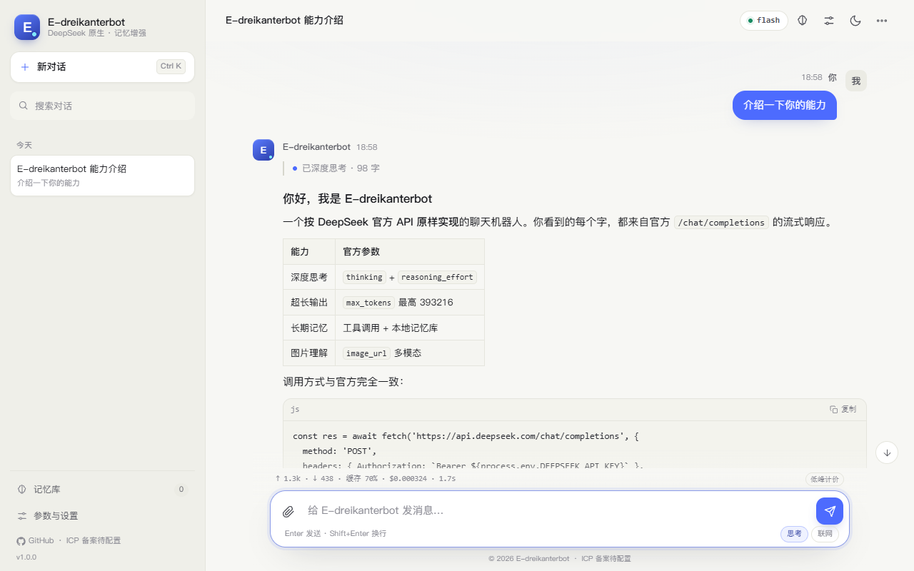
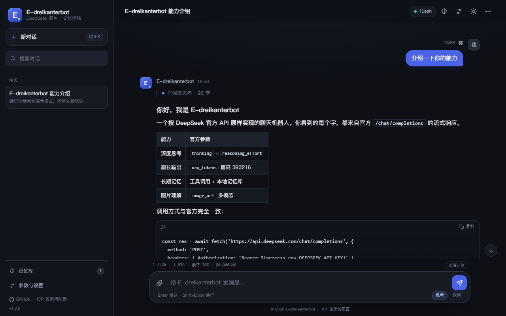
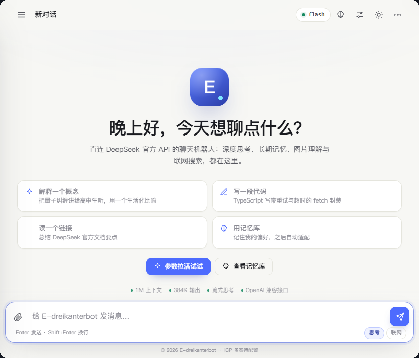

# E-dreikanterbot

**按 DeepSeek 官方 API 原样打造的聊天机器人**：零依赖、单命令启动、全设备自适应，自带长期记忆库与 OpenAI 兼容接口。

[](https://github.com/Ansel-official/E-dreikanterbot/actions/workflows/ci.yml)
[](https://nodejs.org/)
[](LICENSE)
[](package.json)



---

## 这是什么

一个可以直接部署的 DeepSeek 聊天机器人，不是套壳：

- **官方参数直通**：`thinking` / `reasoning_effort` / `max_tokens`（最高 393216）/ `temperature` / `top_p` / `stop` / `response_format` / `tools` / `safety_check` / `title` / `user_id`
- **原样解析官方流**：`reasoning_content` 思考链、`usage`（含缓存命中）、`finish_reason`、官方错误码
- **长期记忆库**：本地 BM25 检索 + Top-K 注入；模型可通过 `remember_fact` / `recall_memory` 工具主动读写
- **图片理解**：支持 JPG / PNG / WebP / GIF，按官方 `image_url` 多模态格式发送
- **OpenAI 兼容接口**：`/v1/chat/completions`、`/v1/models`，任何 OpenAI SDK / 客户端都能接
- **全设备自适应**：桌面三栏、平板抽屉、手机底部输入；PWA 可安装、离线壳、安全区适配
- **零依赖**：没有 `npm install`，没有构建步骤，`node server.js` 即启动

> 默认模型 `deepseek-flash`（V4.1 Flash，1M 上下文，支持视觉）；可选 `deepseek-v4-pro`（更强推理）。

---

## 60 秒快速开始

要求：**Node.js ≥ 20**（不需要 npm）。

```bash
git clone https://github.com/Ansel-official/E-dreikanterbot.git
cd E-dreikanterbot
cp .env.example .env        # Windows: copy .env.example .env
# 编辑 .env，填入 DEEPSEEK_API_KEY
node server.js
```

打开 <http://localhost:8788>。

没有 API Key 也能先看界面：

```bash
node demo/dev.js            # 本地 mock 上游，不调用真实 API、不产生费用
# http://127.0.0.1:8789
```

启动前自检：

```bash
node scripts/check.js
```

真实链路自测（会产生极少量费用，默认 256 tokens 输出）：

```bash
node scripts/smoke.js
```

---

## 它和官方 API 的对应关系

| 官方能力 | 本项目实现 |
| --- | --- |
| `POST /chat/completions` | 服务端 `src/deepseek.js`，流式 + 非流式 |
| `thinking: {type}` / `reasoning_effort` | 参数面板「深度思考」+ low/high/max |
| `max_tokens` 1–393216 | 8K / 64K / 128K / 384K 预设与「参数拉满」 |
| `reasoning_content` | 可折叠思考面板，实时流式显示 |
| `usage` / 缓存字段 | 输入、输出、缓存命中率、费用估算 |
| 上下文缓存 | 稳定 system 前缀 + 记忆按写入时间排序，尽量命中 |
| `deepseek_web_search` / `deepseek_read_url` | 「联网搜索」「读取链接」开关 |
| 图片输入 `image_url` | 粘贴、拖拽、相册上传，自动压缩到 1600px |
| `title` 扩展 | 自动命名会话，可手动覆盖 |
| `safety_check` | 默认 high，可在参数面板切换 |
| `finish_reason` / 错误码 | 前端错误卡片 + 官方提示与重试建议 |
| OpenAI 兼容 | `/v1/chat/completions`、`/v1/models` |

参数含义、取值范围与「哪些参数会被官方忽略」见 [docs/API.md](docs/API.md)。

---

## 截图

| 桌面端 | 深色模式 |
| --- | --- |
|  |  |

| 记忆库 | 参数面板 |
| --- | --- |
|  |  |

| 手机端 | 平板端 |
| --- | --- |
|  |  |

---

## 记忆库是怎么工作的

三层结构，全部落在本地 `data/` 目录：

1. **会话存档**：一条会话一个 JSON，消息、思考过程、工具调用、用量全部持久化。
2. **长期记忆**：`data/memory.json`，可手动添加 / 置顶 / 删除，也可由模型调用工具写入。
3. **上下文预算**：按 token 估算裁剪历史，保留 system 人设、记忆块与最近消息。

每轮请求按以下顺序拼 system：

```text
[人设] → [Top-K 记忆块（按写入时间升序）] → [日期/时区]
```

**为什么按写入时间而不是相关度排序？** DeepSeek 的磁盘缓存按前缀匹配。固定顺序能让新增记忆只影响尾部，旧前缀仍可命中缓存。相关度只用于挑选条目，不改变拼接顺序。

细节见 [docs/MEMORY.md](docs/MEMORY.md)。

---

## API 一览

### 原生接口（网页使用，事件流）

```bash
curl -N http://localhost:8788/api/chat \
  -H 'Content-Type: application/json' \
  -H 'X-Requested-With: E-dreikanterbot' \
  -H "Cookie: edb_session=..." \
  -d '{
    "message": "用一句话解释量子纠缠",
    "settings": {
      "model": "deepseek-flash",
      "thinking": true,
      "reasoning_effort": "high",
      "max_tokens": 4096
    }
  }'
```

SSE 事件：`meta` → `reasoning` / `content` / `tool` → `usage` → `title` → `done`，错误为 `error`。

### OpenAI 兼容接口

先在 `.env` 设置 `ACCESS_TOKEN`，然后：

```bash
curl http://localhost:8788/v1/chat/completions \
  -H "Authorization: Bearer $ACCESS_TOKEN" \
  -H 'Content-Type: application/json' \
  -d '{
    "model": "deepseek-flash",
    "messages": [{"role": "user", "content": "你好"}],
    "thinking": {"type": "enabled"},
    "reasoning_effort": "high",
    "stream": true
  }'
```

Python / JS SDK 只需把 `base_url` 指过来：

```python
from openai import OpenAI

client = OpenAI(api_key="<ACCESS_TOKEN>", base_url="http://localhost:8788/v1")
resp = client.chat.completions.create(
    model="deepseek-flash",
    messages=[{"role": "user", "content": "你好"}],
)
print(resp.choices[0].message.content)
```

完整接口、参数与错误码：[docs/API.md](docs/API.md)。

---

## 配置

全部通过 `.env`（或环境变量）配置，最少只需要一项：

```dotenv
DEEPSEEK_API_KEY=sk-...
```

常用项：

| 变量 | 默认 | 说明 |
| --- | --- | --- |
| `PORT` | `8788` | 监听端口 |
| `HOST` | `0.0.0.0` | 监听地址 |
| `DEFAULT_MODEL` | `deepseek-flash` | 默认模型 |
| `ACCESS_TOKEN` | 空 | 对外访问密码；公网部署**必须**设置 |
| `MEMORY_ENABLED` | `true` | 是否启用记忆库 |
| `MEMORY_TOP_K` | `8` | 每轮注入记忆条数 |
| `MAX_CONTEXT_TOKENS` | `900000` | 历史预算 |
| `SAFETY_LEVEL` | `high` | 官方内容安全等级 |
| `DEFAULT_MAX_TOKENS` | `65536` | 默认最大输出 |
| `ICP_NUMBER` | 空 | 备案号，显示在页脚 |
| `POLICE_NUMBER` | 空 | 公安联网备案号 |
| `TRUST_PROXY` | `0` | nginx 后设为 `1`，用于取真实 IP |

完整列表见 [`.env.example`](.env.example)。

---

## 部署

- 单机 systemd + Nginx（含 SSE 反向代理配置）：[docs/DEPLOY.md](docs/DEPLOY.md)
- Docker / Docker Compose：仓库内 `Dockerfile`、`docker-compose.yml`
- HTTPS：推荐 Caddy 或 certbot
- 公网部署清单：`ACCESS_TOKEN`、HTTPS、`SAFETY_LEVEL=high`、ICP 备案、日志与备份

**关于 ICP 备案**：在中国大陆公网提供服务，需要完成 ICP 备案（经营性服务还涉及其他资质），生成式 AI 服务还涉及算法/服务备案与内容安全义务。本仓库提供页脚展示位与操作清单，但**不能代替你向主管部门备案**。详见 [docs/ICP.md](docs/ICP.md)。

---

## 设备适配

| 断点 | 行为 |
| --- | --- |
| ≥ 901px | 固定侧栏 + 居中对话 + 右侧抽屉 |
| 561–900px | 侧栏收起为抽屉，顶栏汉堡菜单 |
| ≤ 560px | 单列消息、隐藏次要提示、紧凑输入区 |
| 刘海屏 / 手势条 | `viewport-fit=cover` + `env(safe-area-inset-*)` |

支持 PWA 安装（iOS Safari「添加到主屏幕」、Android Chrome、桌面 Chrome/Edge），带离线壳。

自检不同视口：启动后打开 `/preview.html?device=mobile`（仅演示模式允许同源 iframe）。详见 [docs/DEVICES.md](docs/DEVICES.md)。

---

## 测试

```bash
node tests/run.js
```

当前 **36 项**测试，覆盖：

- SSE 跨块 / CRLF / 多行 data 解析
- 会话持久化、重新生成、导入导出
- 记忆去重、中文分词、BM25 检索、缓存友好的排序
- 官方参数组装（thinking / max_tokens / safety_check / title / user_id）
- 工具调用两轮循环与 `reasoning_content` 回传
- 图片校验、附件回读
- 鉴权、CSRF、限流、路径穿越、安全响应头
- `/v1` 流式与非流式、错误码映射、CORS

测试不需要 API Key，使用本地 mock 上游。

---

## 目录结构

```text
E-dreikanterbot/
├─ server.js              # 启动入口
├─ src/
│  ├─ app.js              # HTTP 路由、鉴权、SSE、/v1
│  ├─ chat.js             # 对话编排、工具循环、持久化
│  ├─ deepseek.js         # 官方 API 客户端、SSE 解析、错误码
│  ├─ context.js          # 上下文拼装与裁剪
│  ├─ store.js            # 会话存储 + 长期记忆 + BM25
│  ├─ files.js            # 图片校验与附件
│  ├─ pricing.js          # 官方计价与峰谷判断
│  ├─ config.js           # env 配置
│  └─ static.js           # 静态资源（ETag/gzip）
├─ public/                # 零构建前端
├─ demo/                  # mock 上游 + 演示模式
├─ tests/                 # 36 项测试
├─ docs/                  # API / 记忆库 / 部署 / ICP / 设备
└─ scripts/               # 预检、smoke、图标生成
```

---

## 路线图

- [ ] Mermaid / LaTeX 渲染（当前为安全 Markdown 子集）
- [ ] 会话级多用户与配额
- [ ] 记忆向量检索（可选，不破坏现有 BM25）
- [ ] 语音输入 / 朗读（官方 ASR / TTS）
- [ ] 工具市场（MCP / 自定义函数）

---

## 安全与隐私

- API Key 只存在服务端 `.env`，不会下发到浏览器
- 会话、记忆、图片默认存本地 `data/`，不经过第三方
- 密码登录使用 HMAC 签名 Cookie；所有写操作校验自定义请求头
- CSP、`X-Frame-Options`（生产为 DENY）、路径穿越防护、限流默认开启
- 公网部署请务必设置 `ACCESS_TOKEN`、启用 HTTPS，并阅读 [SECURITY.md](SECURITY.md)

---

## License

[MIT](LICENSE) © 2026 Ansel

本项目与 DeepSeek 官方无隶属关系；DeepSeek、DeepSeek API 是其权利人商标。使用 API 需遵守 [DeepSeek 开放平台服务条款](https://cdn.deepseek.com/policies/zh-CN/deepseek-open-platform-terms-of-service.html)。
