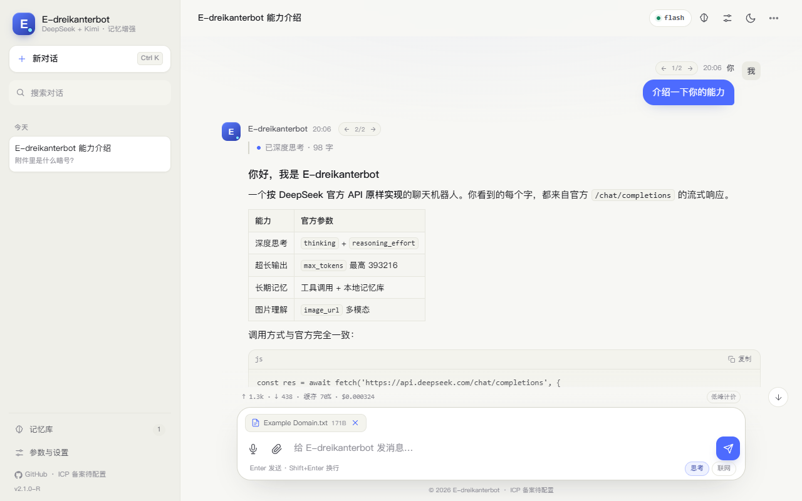
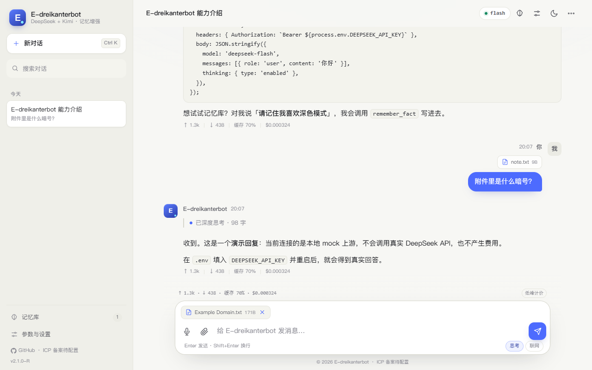
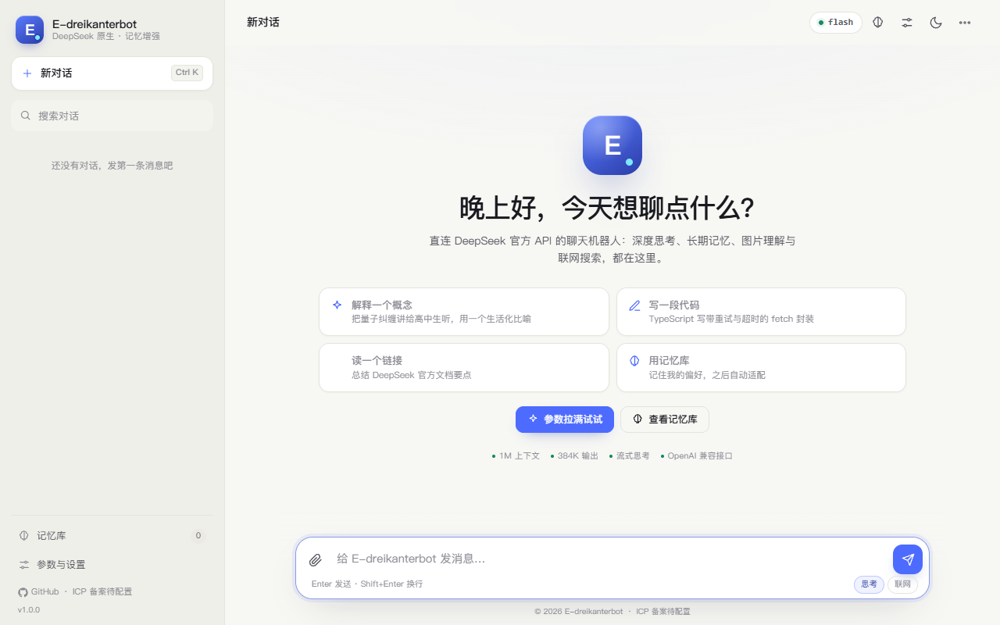
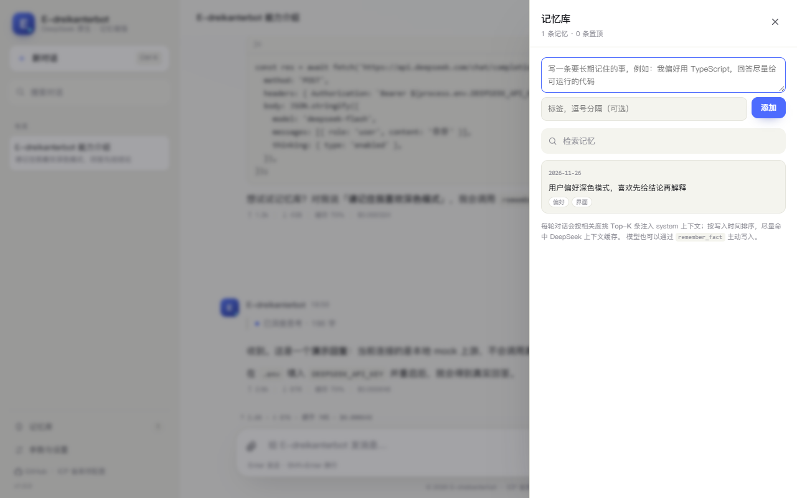
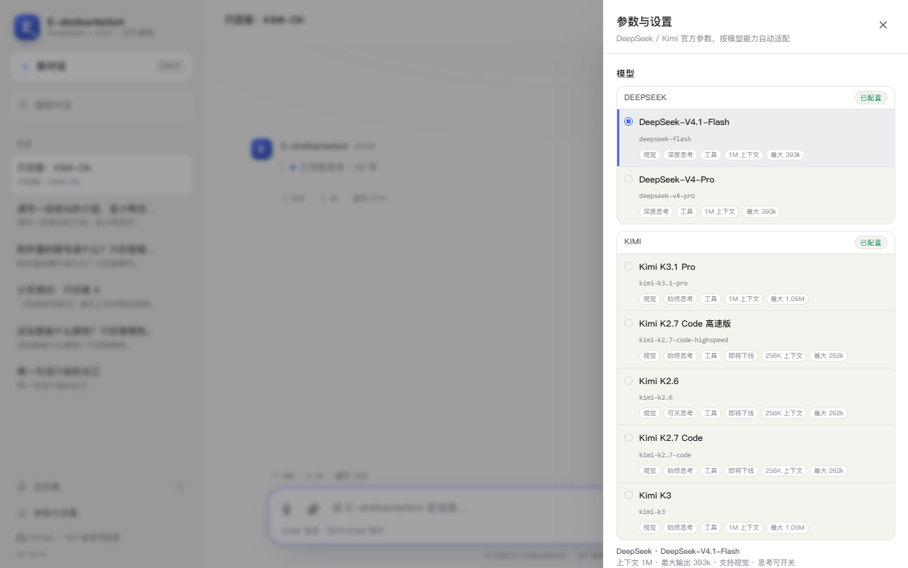
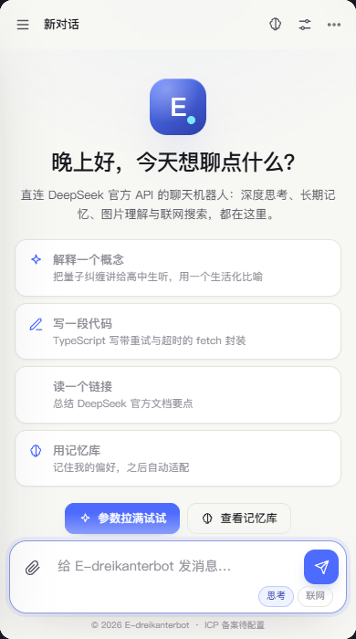

# E-dreikanterbot

**V2.1.R：对齐 DeepSeek 官方 chat-demo 的聊天体验 + DeepSeek / Kimi 双 Provider + 本地长期记忆库**。零依赖、单命令启动、全设备自适应，聊天记录与分支可持久续聊。

[](https://github.com/Ansel-official/E-dreikanterbot/actions/workflows/ci.yml)
[](https://nodejs.org/)
[](LICENSE)
[](package.json)
[](https://github.com/Ansel-official/E-dreikanterbot/releases)



> 参考官方 [chat-demo](https://github.com/deepseek-ai/chat-demo)（MIT）的功能设计，用零依赖 vanilla + Node 重新实现，并扩展了双 Provider 与服务端记忆库；不是直接复制其 React 代码。

---

## 这是什么

一个可以直接部署的双上游聊天机器人，不是套壳：

- **对齐官方 chat-demo 的会话体验**：多会话、自动标题、编辑提问、重新生成、消息分支/版本切换、中断后续写、停止生成、附件、网页读取、语音输入、回复朗读、Markdown/代码高亮、浅色/深色、导入导出
- **双 Provider，所有模型**：DeepSeek 与 Kimi（Moonshot）官方 `/models` 动态发现；模型列表、上下文、最大输出、视觉/思考/工具能力全部来自官方元数据或官方文档
- **DeepSeek 官方参数直通**：`thinking` / `reasoning_effort` / `max_tokens`（最高 393216）/ `temperature` / `top_p` / `stop` / `response_format` / `tools` / `safety_check` / `title` / `user_id`
- **Kimi 官方参数适配**：K3 系列始终思考，使用顶层 `reasoning_effort`；输出用 `max_completion_tokens`（最高 1M）；`prompt_cache_key`、`safety_identifier`、`cache_write_tokens` 均已适配；不会误传 `thinking` / `temperature` / `top_p`
- **原样解析官方流**：`reasoning_content` 思考链、`usage`（缓存命中/写入）、`finish_reason`、来源引用、官方错误码
- **长期记忆库**：本地 BM25 检索 + Top-K 注入；模型可通过 `remember_fact` / `recall_memory` 工具主动读写；支持“记住这段对话”与记忆库 JSON 导入导出
- **继续聊**：会话、分支、未完成草稿、上次打开位置都持久化；重新打开页面自动回到上次对话
- **附件与读网页**：图片 + txt/md/csv/json/log 文本附件；任意公开网页一键提取正文，作为附件参与对话（含 SSRF 防护）
- **OpenAI 兼容接口**：`/v1/chat/completions`、`/v1/models`，按模型自动路由到 DeepSeek 或 Kimi
- **全设备自适应**：桌面三栏、平板抽屉、手机底部输入；PWA 可安装、离线壳、安全区适配
- **零依赖**：没有 `npm install`，没有构建步骤，`node server.js` 即启动

> 默认 `deepseek-flash`（V4.1 Flash，1M 上下文，支持视觉）；可切换到 `deepseek-v4-pro` 或 Kimi `kimi-k3.1-pro` / `kimi-k3.1-pro-highspeed` / `kimi-k3` / `kimi-k2.7-code` / `kimi-k2.6`。

---

## V2.1.R 新增

| 能力 | 说明 |
| --- | --- |
| 消息分支 | 编辑提问/重新生成不会覆盖旧回答，生成兄弟分支；`‹ 2/3 ›` 切换版本 |
| 继续生成 | 回答被 `length` 截断或手动停止后，可点“继续”从断点续写（DeepSeek / Kimi 都可用） |
| 文本附件 | 拖拽/粘贴/选择 txt、md、csv、json、log；单文件 20 万字符、合计 50 万字符 |
| 网页读取 | 输入 URL，服务端抓取正文并作为附件；拒绝内网/本机地址，限制 2MB |
| 语音输入 | 浏览器 Web Speech API，Chrome / Edge 可用；边说边转写 |
| 回复朗读 | 浏览器 SpeechSynthesis，一键朗读回答 |
| 记忆库增强 | “记住这段对话”、记忆库导出/导入、置顶/搜索 |
| 来源引用 | 解析 DeepSeek 搜索返回的 `annotations`，在回答下方展示来源链接 |
| 版本/缓存 | 前端资源与 Service Worker 全量刷新，避免旧缓存 |

> 尚未内置：KaTeX 公式、Mermaid 图表、ZIP 格式历史归档（当前用 JSON 导入导出，更透明）、服务端 ASR/TTS。它们不影响聊天、分支与记忆主链路。

### 与官方 chat-demo 的对照

| 能力 | 官方 chat-demo | 本项目 V2.1.R |
| --- | --- | --- |
| 多会话 / 自动标题 / 重命名删除 | ✅ | ✅ |
| 编辑提问 / 重新生成 / 消息分支 | ✅ | ✅ |
| 截止后续写 | ✅ | ✅（隐藏续写指令） |
| 停止生成 | ✅ | ✅ |
| 附件 | 图片 + 文件（Files API） | 图片 + txt/md/csv/json/log |
| 网页读取 | ✅（服务端扩展） | ✅（服务端抓取 + SSRF 防护） |
| 搜索与来源引用 | ✅ | DeepSeek 搜索 + `annotations` 引用；Kimi 无搜索 |
| 语音输入 / 朗读 | ✅（ASR/TTS API） | ✅（浏览器 Web Speech / SpeechSynthesis） |
| Markdown / 代码高亮 | ✅ | ✅ |
| KaTeX / Mermaid | ✅ | ❌ |
| 中英文 / 主题 | ✅ | 中文 + 浅色/深色/跟随系统 |
| 历史导入导出 | ZIP | JSON |
| 长期记忆库 | ❌ | ✅ BM25 + 工具 + 摘要 + 导入导出 |
| 双 Provider | ❌（仅 DeepSeek） | ✅ DeepSeek + Kimi |
| Key 管理 | 浏览器 localStorage | 服务端 `.env`（不下发前端） |

---

## 60 秒快速开始

要求：**Node.js ≥ 20**（不需要 npm）。

```bash
git clone https://github.com/Ansel-official/E-dreikanterbot.git
cd E-dreikanterbot
cp .env.example .env        # Windows: copy .env.example .env
# 编辑 .env，填入 DEEPSEEK_API_KEY 和/或 KIMI_API_KEY
node server.js
```

打开 <http://localhost:8788>。

两个 Key 至少配一个：

```dotenv
DEEPSEEK_API_KEY=sk-...          # DeepSeek 开放平台
KIMI_API_KEY=sk-...              # Moonshot 开放平台（Kimi）
```

没有 API Key 也能先看界面：

```bash
node demo/dev.js            # 本地 mock 上游（DeepSeek + Kimi），不调用真实 API、不产生费用
# http://127.0.0.1:8789
```

启动前自检：

```bash
node scripts/check.js
```

真实链路自测（会产生极少量费用，默认 256 tokens 输出）：

```bash
node scripts/smoke.js                          # 默认模型
node scripts/smoke.js deepseek-flash "你好"
node scripts/smoke.js kimi-k3.1-pro "你好"     # 需配置 KIMI_API_KEY
```

---

## 它和官方 API 的对应关系

| 官方能力 | DeepSeek | Kimi |
| --- | --- | --- |
| `POST /chat/completions` | ✅ 流式 + 非流式 | ✅ 流式 + 非流式 |
| 思考开关 | `thinking: {type}` | K3 不支持，始终思考；K2.6 支持 |
| 思考强度 | `reasoning_effort` low/high/max | K3 支持 low/high/max（默认 max） |
| 最大输出 | `max_tokens` ≤ 393216 | `max_completion_tokens` ≤ 1048576 |
| 思考内容 | `reasoning_content` | `reasoning_content` + Preserved Thinking |
| 采样参数 | `temperature` / `top_p` | 固定 1.0 / 0.95，不发送 |
| 缓存 | `prompt_cache_hit_tokens` / `miss` | `prompt_tokens_details.cached_tokens` / `cache_write_tokens` |
| 联网工具 | `deepseek_web_search` / `deepseek_read_url` | 不提供；UI 自动禁用 |
| 图片输入 | `image_url` | `image_url` / `video_url`（K3 系列） |
| 会话标题 | `title` 扩展 | 不支持，使用本地标题 |
| 内容安全 | `safety_check` | `safety_identifier` |
| 用户标识 | `user_id` | `safety_identifier` / `prompt_cache_key` |
| OpenAI 兼容 | `/v1/chat/completions` | 同一入口，按模型路由 |

参数含义、模型能力与「哪些参数会被官方忽略」见 [docs/API.md](docs/API.md)。

### 模型选择

模型列表不是写死的：服务端启动时会分别请求两家的 `GET /models`，合并为统一目录；Kimi 未配置 Key 时仍会展示官方模型，但标记为不可选。

| Provider | 当前模型 |
| --- | --- |
| DeepSeek | `deepseek-flash`（视觉）、`deepseek-v4-pro`（文本强推理） |
| Kimi | `kimi-k3.1-pro`、`kimi-k3.1-pro-highspeed`、`kimi-k3`、`kimi-k2.7-code`*、`kimi-k2.6`* |

\* K2.7 / K2.6 已对新人停止开放，是否可用以 `/models` 返回为准，UI 会标注「即将下线」。

---

## 截图

| 消息分支 / 编辑重新生成 | 文本附件 / 网页读取 |
| --- | --- |
|  |  |

| 桌面端 | 深色模式 |
| --- | --- |
|  |  |

| 记忆库 | 参数面板 |
| --- | --- |
|  |  |

| 手机端 | 平板端 |
| --- | --- |
|  |  |

> 截图为内置演示模式（DeepSeek + Kimi 本地 mock）录制；填入真实 Key 后，回答由对应官方 API 生成。

---

## 记忆库是怎么工作的

三层结构，全部落在本地 `data/` 目录：

1. **会话存档**：一条会话一个 JSON，消息、思考过程、工具调用、用量全部持久化。
2. **长期记忆**：`data/memory.json`，可手动添加 / 置顶 / 删除，也可由模型调用工具写入。
3. **上下文预算**：按 token 估算裁剪历史，保留 system 人设、记忆块与最近消息。

每轮请求按以下顺序拼 system：

```text
[人设] → [Top-K 记忆块（按写入时间升序）] → [日期/时区]
```

**为什么按写入时间而不是相关度排序？** DeepSeek 的磁盘缓存按前缀匹配。固定顺序能让新增记忆只影响尾部，旧前缀仍可命中缓存。相关度只用于挑选条目，不改变拼接顺序。

细节见 [docs/MEMORY.md](docs/MEMORY.md)。

---

## API 一览

### 原生接口（网页使用，事件流）

```bash
curl -N http://localhost:8788/api/chat \
  -H 'Content-Type: application/json' \
  -H 'X-Requested-With: E-dreikanterbot' \
  -H "Cookie: edb_session=..." \
  -d '{
    "message": "用一句话解释量子纠缠",
    "settings": {
      "model": "kimi-k3.1-pro",
      "reasoning_effort": "high",
      "max_tokens": 4096
    }
  }'
```

换成 `deepseek-flash` 时，可额外传 `thinking` / `safety_check` / `title`；服务端会按模型自动只发送该 Provider 支持的参数。

SSE 事件：`meta` → `reasoning` / `content` / `tool` → `usage` → `title` → `done`，错误为 `error`。`meta` 会带上 `provider`、`providerName`、`contextWindow`。

分支与续写：

```json
{ "conversationId": "c_...", "editMessageId": "m_...", "message": "改后的提问" }
{ "conversationId": "c_...", "regenerate": true }
{ "conversationId": "c_...", "continue": true }
{ "conversationId": "c_...", "message": "总结附件", "textFiles": [{ "name": "notes.md", "text": "..." }] }
```

- `editMessageId`：在同一个父节点下创建新的用户分支，旧分支保留。
- `regenerate`：保留旧回答，新建助手兄弟分支。
- `continue`：插入隐藏续写指令，用于 `finish_reason=length` 或手动停止后的续写。
- `textFiles`：最多 4 个，单文件 20 万字符、合计 50 万字符，注入为 `<file>` 上下文。

切换分支：`POST /api/conversations/:id/select`，body `{ "messageId": "m_..." }`。

网页读取：`POST /api/read-url`，body `{ "url": "https://..." }`，返回 `{ data: { title, text, url, chars } }`；拒绝内网/本机地址。

记忆库：`GET /api/memory/export` 下载 JSON；`POST /api/memory/import` body `{ "facts": [{ "text": "...", "tags": ["..."] }] }`。

### OpenAI 兼容接口

先在 `.env` 设置 `ACCESS_TOKEN`，然后：

```bash
curl http://localhost:8788/v1/chat/completions \
  -H "Authorization: Bearer $ACCESS_TOKEN" \
  -H 'Content-Type: application/json' \
  -d '{
    "model": "deepseek-flash",
    "messages": [{"role": "user", "content": "你好"}],
    "thinking": {"type": "enabled"},
    "reasoning_effort": "high",
    "stream": true
  }'
```

Python / JS SDK 只需把 `base_url` 指过来：

```python
from openai import OpenAI

client = OpenAI(api_key="<ACCESS_TOKEN>", base_url="http://localhost:8788/v1")
resp = client.chat.completions.create(
    model="kimi-k3.1-pro",  # 或 deepseek-flash
    messages=[{"role": "user", "content": "你好"}],
)
print(resp.choices[0].message.content)
```

`/v1` 会按 `model` 自动选择 Provider，并改写参数（Kimi 用 `max_completion_tokens`，移除 `thinking`/`temperature`/`top_p`）。也可以用 `kimi/kimi-k3.1-pro` 这种带 Provider 前缀的写法。

完整接口、参数与错误码：[docs/API.md](docs/API.md)。

---

## 配置

全部通过 `.env`（或环境变量）配置，至少配置一个上游 Key：

```dotenv
DEEPSEEK_API_KEY=sk-...   # 二选一或都配
KIMI_API_KEY=sk-...
```

常用项：

| 变量 | 默认 | 说明 |
| --- | --- | --- |
| `PORT` | `8788` | 监听端口 |
| `HOST` | `0.0.0.0` | 监听地址 |
| `DEEPSEEK_API_KEY` | 空 | DeepSeek Key |
| `KIMI_API_KEY` | 空 | Kimi / Moonshot Key |
| `KIMI_BASE_URL` | `https://api.moonshot.cn/v1` | 海外可改 `https://api.moonshot.ai/v1` |
| `DEFAULT_MODEL` | `deepseek-flash` | 默认模型（必须是 `/api/models` 中的 ID） |
| `ACCESS_TOKEN` | 空 | 对外访问密码；公网部署**必须**设置 |
| `MEMORY_ENABLED` | `true` | 是否启用记忆库 |
| `MEMORY_TOP_K` | `8` | 每轮注入记忆条数 |
| `MAX_CONTEXT_TOKENS` | `900000` | 历史预算（按模型上下文再收窄） |
| `SAFETY_LEVEL` | `high` | 仅 DeepSeek 的内容安全等级 |
| `DEFAULT_MAX_TOKENS` | `65536` | 默认最大输出 |
| `ICP_NUMBER` | 空 | 备案号，显示在页脚 |
| `POLICE_NUMBER` | 空 | 公安联网备案号 |
| `TRUST_PROXY` | `0` | nginx 后设为 `1`，用于取真实 IP |

完整列表见 [`.env.example`](.env.example)。

---

## 部署

- 单机 systemd + Nginx（含 SSE 反向代理配置）：[docs/DEPLOY.md](docs/DEPLOY.md)
- Docker / Docker Compose：仓库内 `Dockerfile`、`docker-compose.yml`
- HTTPS：推荐 Caddy 或 certbot
- 公网部署清单：`ACCESS_TOKEN`、HTTPS、`SAFETY_LEVEL=high`、ICP 备案、日志与备份

**关于 ICP 备案**：在中国大陆公网提供服务，需要完成 ICP 备案（经营性服务还涉及其他资质），生成式 AI 服务还涉及算法/服务备案与内容安全义务。本仓库提供页脚展示位与操作清单，但**不能代替你向主管部门备案**。详见 [docs/ICP.md](docs/ICP.md)。

---

## 设备适配

| 断点 | 行为 |
| --- | --- |
| ≥ 901px | 固定侧栏 + 居中对话 + 右侧抽屉 |
| 561–900px | 侧栏收起为抽屉，顶栏汉堡菜单 |
| ≤ 560px | 单列消息、隐藏次要提示、紧凑输入区 |
| 刘海屏 / 手势条 | `viewport-fit=cover` + `env(safe-area-inset-*)` |

支持 PWA 安装（iOS Safari「添加到主屏幕」、Android Chrome、桌面 Chrome/Edge），带离线壳。

自检不同视口：启动后打开 `/preview.html?device=mobile`（仅演示模式允许同源 iframe）。详见 [docs/DEVICES.md](docs/DEVICES.md)。

---

## 测试

```bash
node tests/run.js
```

当前 **45 项**测试，覆盖：

- SSE 跨块 / CRLF / 多行 data 解析
- 会话持久化、消息分支/版本切换、编辑/重新生成、继续生成
- 记忆去重、中文分词、BM25 检索、缓存友好的排序、记忆导入导出
- DeepSeek 参数组装（thinking / max_tokens / safety_check / title / user_id）
- Kimi K3 参数适配（reasoning_effort / max_completion_tokens / 无 thinking / 无采样参数）
- Kimi 缓存写入用量、视觉能力按模型校验
- 文本附件注入、网页读取与内网 SSRF 拒绝
- 工具调用两轮循环与 `reasoning_content` 回传
- 图片校验、附件回读
- 鉴权、CSRF、限流、路径穿越、安全响应头
- `/v1` 双 Provider 路由、流式与非流式、错误码映射、CORS

测试不需要 API Key，使用本地 mock 上游。

---

## 目录结构

```text
E-dreikanterbot/
├─ server.js              # 启动入口
├─ src/
│  ├─ app.js              # HTTP 路由、鉴权、SSE、/v1
│  ├─ deepseek.js         # 通用上游客户端、SSE 解析、错误码
│  ├─ providers.js        # DeepSeek / Kimi 模型目录与能力适配
│  ├─ webread.js          # 网页正文提取 + SSRF 防护
│  ├─ chat.js             # 对话编排、工具循环、Provider 参数
│  ├─ context.js          # 上下文拼装与裁剪
│  ├─ store.js            # 会话存储 + 长期记忆 + BM25
│  ├─ files.js            # 图片校验与附件
│  ├─ pricing.js          # 官方计价与峰谷判断
│  ├─ config.js           # env 配置
│  └─ static.js           # 静态资源（ETag/gzip）
├─ public/                # 零构建前端
├─ demo/                  # mock 上游 + 演示模式
├─ tests/                 # 45 项测试
├─ docs/                  # API / 记忆库 / 部署 / ICP / 设备
└─ scripts/               # 预检、smoke、图标生成
```

---

## 路线图

- [ ] Mermaid / LaTeX 渲染（当前为安全 Markdown 子集）
- [ ] 会话级多用户与配额
- [ ] 记忆向量检索（可选，不破坏现有 BM25）
- [ ] 语音输入 / 朗读（官方 ASR / TTS）
- [ ] 工具市场（MCP / 自定义函数）

---

## 安全与隐私

- API Key 只存在服务端 `.env`，不会下发到浏览器
- 会话、记忆、图片默认存本地 `data/`，不经过第三方
- 密码登录使用 HMAC 签名 Cookie；所有写操作校验自定义请求头
- CSP、`X-Frame-Options`（生产为 DENY）、路径穿越防护、限流默认开启
- 公网部署请务必设置 `ACCESS_TOKEN`、启用 HTTPS，并阅读 [SECURITY.md](SECURITY.md)

---

## License

[MIT](LICENSE) © 2026 Ansel

本项目与 DeepSeek、Moonshot AI 官方均无隶属关系；DeepSeek、Kimi 是其权利人商标。使用 API 需遵守 [DeepSeek 开放平台服务条款](https://cdn.deepseek.com/policies/zh-CN/deepseek-open-platform-terms-of-service.html) 与 [Kimi 开放平台服务条款](https://platform.kimi.com/docs/agreements)。
